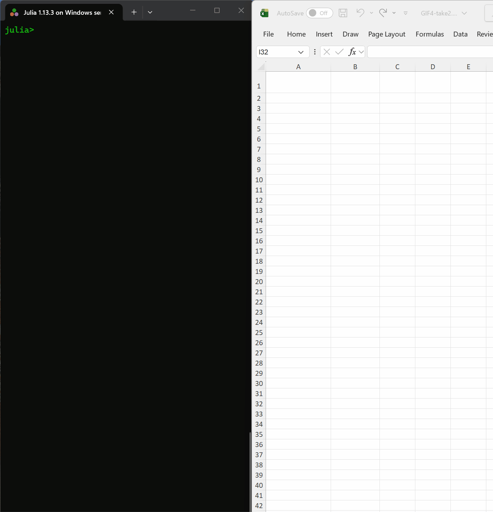

# CallFromExcel.jl - call Julia from Excel

[](https://pgs62.github.io/CallFromExcel.jl/stable/) [](https://pgs62.github.io/CallFromExcel.jl/dev/) [](https://github.com/PGS62/CallFromExcel.jl/actions/workflows/Runtests.yml) [](https://codecov.io/gh/PGS62/CallFromExcel.jl)

Call [Julia](https://julialang.org/) from Microsoft Excel worksheets and from VBA.

CallFromExcel is an Excel add-in that lets you use any Julia function in a worksheet formula. For example, `=JuliaEval("using LinearAlgebra")` makes the functions of one of Julia's standard libraries available, then `=JuliaCall("eigvals", A1:J10)` passes a range to Julia as a matrix and returns its eigenvalues to the worksheet (as complex numbers, if the matrix isn't symmetric) - something Excel has no built-in function for. Keep your front end in Excel, and do the heavy computation in Julia.

 * Your own Julia functions can also be worksheet functions in their own right: mark one with `@excel` and call it as `=jl.my_function(A1, B1)` - see [Your own worksheet functions](https://pgs62.github.io/CallFromExcel.jl/stable/own_functions/).
 * Keep large or complex Julia objects - a big matrix, a fitted model, a DataFrame - in Julia, and pass them between formulas as [handles](https://pgs62.github.io/CallFromExcel.jl/stable/handles/): short strings such as `jl:Array#17@k3x9` that stand for the objects.
 * A Julia tab on Excel's ribbon starts Julia and loads your Julia files.
 * Compatible with Excel's [dynamic array formulas](https://support.microsoft.com/en-us/office/dynamic-array-formulas-and-spilled-array-behavior-205c6b06-03ba-4151-89a1-87a7eb36e531).
 * Supports 64-bit Excel for Windows (not Mac, not 32-bit Excel).
 * Run Julia under either Windows or Linux (via [WSL](https://docs.microsoft.com/en-us/windows/wsl/about)).
 * Installation doesn't need admin rights.
 * CallFromExcel is the successor to [JuliaExcel](https://github.com/PGS62/JuliaExcel.jl), with its Excel add-in rewritten from VBA to C# for speed. See [Upgrading from JuliaExcel](#upgrading-from-juliaexcel).

**Documentation: https://pgs62.github.io/CallFromExcel.jl/stable/**

<a href="#no-click">
  
</a>

## Installation
Close Excel, launch Julia, and copy-paste the following commands into the REPL:
```
using Pkg
Pkg.add("CallFromExcel")
using CallFromExcel
CallFromExcel.installme()

```
`Pkg.add` installs the Julia package, and `installme()` installs the Excel add-in. After updating CallFromExcel, close Excel and run `installme()` again. See [Installation](https://pgs62.github.io/CallFromExcel.jl/stable/installation/) in the documentation for more, including running Julia under Linux (WSL), and uninstalling.

## Upgrading from JuliaExcel
CallFromExcel replaces [JuliaExcel](https://github.com/PGS62/JuliaExcel.jl). Its worksheet functions have the same names, but some changes are needed to workbooks and code written for JuliaExcel - see [Upgrading from JuliaExcel](https://pgs62.github.io/CallFromExcel.jl/stable/installation/#upgrading-from-juliaexcel) in the documentation.

## Functions
<!-- The <a name> anchors are the "Help on this function" links of CallFromExcel 0.1.x add-ins
(HelpRoot in JuliaFunctions.cs was https://github.com/PGS62/CallFromExcel.jl#). Keep them. -->
The worksheet functions, each linking to its documentation. There are also [functions for VBA](https://pgs62.github.io/CallFromExcel.jl/stable/vba_functions/).

|Name|Description|
|:---|:----------|
|<a name="julialaunch"></a>[JuliaLaunch](https://pgs62.github.io/CallFromExcel.jl/stable/functions/#julialaunch)|Launches a local Julia session which listens to the current Excel session and responds to calls to `JuliaEval` etc.|
|<a name="juliainclude"></a>[JuliaInclude](https://pgs62.github.io/CallFromExcel.jl/stable/functions/#juliainclude)|Load a Julia source file into the Julia process, to make additional functions available via `JuliaEval` and `JuliaCall`.|
|<a name="juliaeval"></a>[JuliaEval](https://pgs62.github.io/CallFromExcel.jl/stable/functions/#juliaeval)|Evaluate a Julia expression and return the result to an Excel worksheet, or a handle to the result.|
|<a name="juliacall"></a>[JuliaCall](https://pgs62.github.io/CallFromExcel.jl/stable/functions/#juliacall)|Call a named Julia function, passing in data from the worksheet.|
|<a name="juliasetvar"></a>[JuliaSetVar](https://pgs62.github.io/CallFromExcel.jl/stable/functions/#juliasetvar)|Set a global variable in the Julia process.|
|<a name="juliacallnamedargs"></a>[JuliaCallNamedArgs](https://pgs62.github.io/CallFromExcel.jl/stable/functions/#juliacallnamedargs)|Call a named Julia function, passing positional and named arguments from the worksheet.|
|<a name="juliaisrunning"></a>[JuliaIsRunning](https://pgs62.github.io/CallFromExcel.jl/stable/functions/#juliaisrunning)|Returns TRUE if an instance of Julia is running and "listening" to the current Excel session, or FALSE otherwise.|
|<a name="juliaexcelpid"></a>[JuliaExcelPID](https://pgs62.github.io/CallFromExcel.jl/stable/functions/#juliaexcelpid)|Returns the process id of the current Excel session.|
|[JuliaCallHandle](https://pgs62.github.io/CallFromExcel.jl/stable/functions/#juliacallhandle)|Call a named Julia function and return a handle to the result, which stays in Julia for other functions to use.|
|[JuliaHandleInfo](https://pgs62.github.io/CallFromExcel.jl/stable/functions/#juliahandleinfo)|Information about object handles: how many are live, or recent events.|

&nbsp;

Philip Swannell  
8 December 2021  
Last updated 26 November 2026
