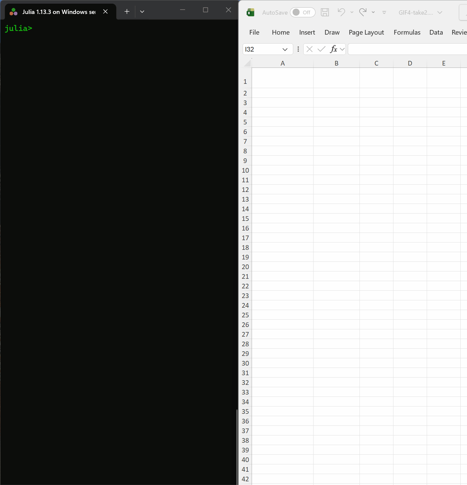
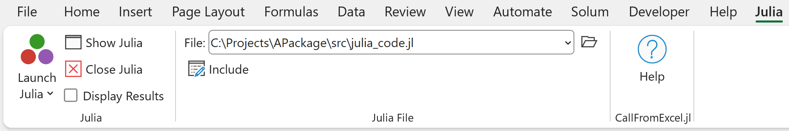
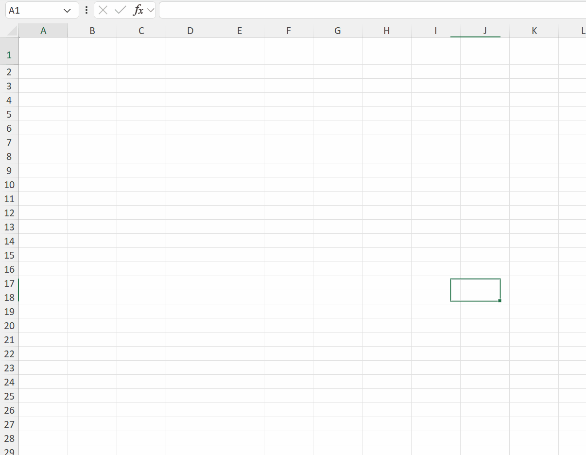
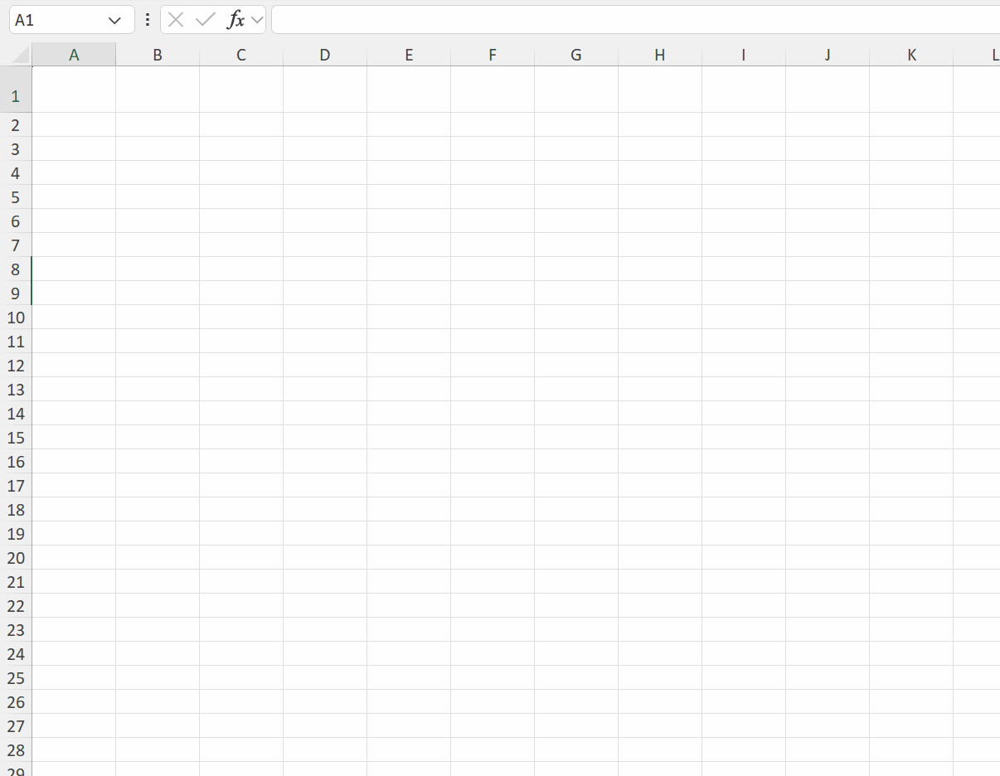
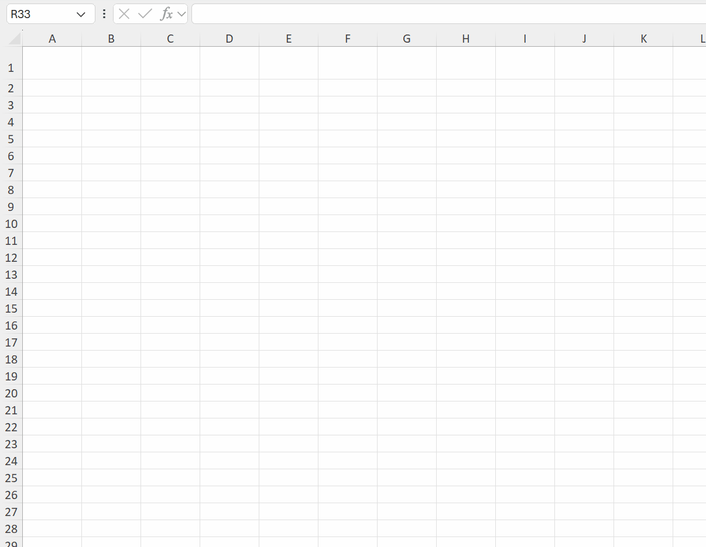

# CallFromExcel.jl - call Julia from Excel

[](https://github.com/PGS62/CallFromExcel.jl/actions/workflows/Runtests.yml) [](https://codecov.io/gh/PGS62/CallFromExcel.jl)

Call [Julia](https://julialang.org/) from Microsoft Excel worksheets and from VBA.  

CallFromExcel is an Excel add-in that lets you use any Julia function in a worksheet formula. For example, `=JuliaEval("using LinearAlgebra")` loads one of Julia's standard libraries, then `=JuliaCall("eigvals", A1:J10)` passes a range to Julia as a matrix and returns its eigenvalues to the worksheet (as complex numbers, if the matrix isn't symmetric) - something Excel has no built-in function for. Keep your front end in Excel, and do the heavy computation in Julia. A Julia tab on Excel's ribbon starts Julia and loads your Julia files. Installation doesn't need admin rights.

CallFromExcel is compatible with Excel's [dynamic array formulas](https://support.microsoft.com/en-us/office/dynamic-array-formulas-and-spilled-array-behavior-205c6b06-03ba-4151-89a1-87a7eb36e531), and supports 64-bit Excel for Windows (not Mac, not 32-bit Excel). It works with Julia running under either Windows or Linux (via [WSL](https://docs.microsoft.com/en-us/windows/wsl/about)).

CallFromExcel is the successor to [JuliaExcel](https://github.com/PGS62/JuliaExcel.jl), with its Excel add-in rewritten from VBA to C# for speed. See [Upgrading from JuliaExcel](#upgrading-from-juliaexcel).

## Contents
[Demo](#demo)  
[Installation](#installation)  
[Installation (Linux)](#installation-linux)  
[The Julia ribbon tab](#the-julia-ribbon-tab)  
[Upgrading from JuliaExcel](#upgrading-from-juliaexcel)  
[Functions](#functions)  
[Example VBA](#example-vba)  
[Function Documentation](#function-documentation)  
[Performance](#performance)  
[Alternatives](#alternatives)  
[Compatibility](#compatibility)  
[Attaching to a Julia session already running elsewhere](#attaching-to-a-julia-session-already-running-elsewhere)  
[Debugging](#debugging)  
[Marshalling](#marshalling)  
[How CallFromExcel works](#how-callfromexcel-works)  
[Viewing the code](#viewing-the-code)  

## Demo
Here's a quick demonstration of CallFromExcel's functions in action.
 * See how the Julia session on the left responds to the action in Excel on the right, once `display_results(true)` has been called (the formula at B6 does this).
 * The annotations in brown text ("Formula at...") are to make what's happening in the demo clearer. They won't appear when you try CallFromExcel for yourself!
 * Replay the GIF by refreshing your browser (F5).

<a href="#no-click">
  
</a>

## Installation
Installation does not require admin rights on the PC.
 * Both Julia and Microsoft Office must be installed on your PC.
 * Close Excel - installation fails if Excel is running.
 * Launch Julia, and copy-paste the following commands into the REPL. To paste into the REPL, right-click.
<!-- CHANGING THE INSTRUCTIONS BELOW? DON'T FORGET TO ALSO CHANGE THE "Installation (Linux)" SECTION -->
   ```
   using Pkg
   Pkg.add("CallFromExcel")
   using CallFromExcel
   CallFromExcel.installme()
   ```
   `Pkg.add` installs the Julia package, and `installme()` installs the Excel add-in.
 * Launch Excel. Check that it shows a Julia tab on the ribbon, and that typing `=Julia` into a worksheet cell makes the auto-complete offer `JuliaCall`, `JuliaEval`, `JuliaInclude` etc.
 * After updating CallFromExcel (e.g. with `Pkg.update()`), close Excel and run `using CallFromExcel; CallFromExcel.installme()` again: the add-in and the Julia package must be the same version, and if they aren't, Excel says so. Do the same if the functions go missing from Excel.
<!--
The process is illustrated in the GIF below. F5 to replay.

<a href="#no-click">
  
</a>
-->

## Installation (Linux)
As an alternative to calling Julia running in a Windows process, CallFromExcel can call Julia running in a Linux process under Windows Subsystem for Linux (WSL). If that's your preference, then in addition to the steps described above, you need to:
 * If necessary, install [WSL](https://docs.microsoft.com/en-us/windows/wsl/install) with the default Linux distribution, Ubuntu.
 * Install Julia under WSL by running `curl -fsSL https://install.julialang.org | sh` at the Ubuntu prompt, per the [official instructions](https://julialang.org/downloads/). This installs `juliaup`, which puts `julia` on the PATH automatically.
 * At the Julia prompt (under WSL) install CallFromExcel by copy-pasting   
  `using Pkg; Pkg.add("CallFromExcel")` into the REPL. 

## The Julia ribbon tab
The add-in adds a Julia tab to Excel's ribbon:



|Control|What it does|
|:------|:-----------|
|**Launch Julia**|Starts Julia for this Excel session, using the Launch Settings.|
|**Launch Settings...**|On Launch Julia's drop-down menu. Sets the project folder, other command line options, packages to load, whether to run under WSL, and so on. The settings are saved for you on this PC.|
|**Show Julia**|Brings Julia's window to the front.|
|**Close Julia**|Closes Julia, after asking for confirmation.|
|**Display Results**|Shows each call from Excel, and its result, in Julia's window - as `CallFromExcel.display_results(true)` does.|
|**File**, **Browse**, **Include**|Choose a Julia file - typed, pasted, browsed to or picked from recently used files - and include it, as `JuliaInclude` does. Include doesn't trigger recalculation.|
|**Help**|Opens this page.|

Launch Julia and a `JuliaLaunch` formula start Julia in the same way, but each with its own settings: a formula uses only its own arguments, so a workbook records how Julia should start and does so the same way on every PC, while the ribbon's Launch Settings are yours.

## Upgrading from JuliaExcel
CallFromExcel replaces [JuliaExcel](https://github.com/PGS62/JuliaExcel.jl). Its worksheet functions have the same names, but some changes are needed to workbooks and code written for JuliaExcel.

**Installation.** Installing CallFromExcel (see [Installation](#installation)) also uninstalls JuliaExcel's Excel add-in, `JuliaExcel.xlam`. The JuliaExcel Julia package is no longer used, and can be removed with `using Pkg; Pkg.rm("JuliaExcel")`.

**Worksheet formulas.** In a workbook saved with JuliaExcel, Excel records the location of `JuliaExcel.xlam` in each formula that uses its functions, so after upgrading a formula such as `=JuliaLaunch()` appears as `='C:\Users\Public\JuliaExcel\JuliaExcel.xlam'!JuliaLaunch()`. Remove that path with Find and Replace (Ctrl+H): set "Within" to Workbook and "Look in" to Formulas, and replace the text `'C:\Users\Public\JuliaExcel\JuliaExcel.xlam'!` with nothing.

**VBA.**
 * Replace the reference to JuliaExcel with one to CallFromExcel (VBA editor, Tools menu -> References).
 * Create an object to call CallFromExcel's functions through, and put it in front of each call, so `JuliaCall("f", x)` becomes `jl.JuliaCall("f", x)` - see [Example VBA](#example-vba):
   ```vba
   Dim jl As New CallFromExcel.ComServer
   ```
 * From VBA, `JuliaCall`, `JuliaCallVBA`, `JuliaCallNamedArgs` and `JuliaCallNamedArgsVBA` take at most 30 arguments after the function name.

**Julia.** Functions and variables formerly accessed as `JuliaExcel.xxx`, such as `JuliaExcel.serve_xl()` and `JuliaExcel.last_answer`, are now `CallFromExcel.xxx`, after `using CallFromExcel`.

## Functions
CallFromExcel makes the following functions available from Excel worksheets and from VBA, except that the three ending in `VBA` can only be called from VBA:

|Name|Description|
|----|-----------|
|[JuliaLaunch](#julialaunch)|Launches a local Julia session which listens to the current Excel session and responds to calls to `JuliaEval` etc.|
|[JuliaInclude](#juliainclude)|Load a Julia source file into the Julia process, to make additional functions available via `JuliaEval` and `JuliaCall`.|
|[JuliaEval](#juliaeval)|Evaluate a Julia expression and return the result to an Excel worksheet.|
|[JuliaCall](#juliacall)|Call a named Julia function, passing in data from the worksheet. Returns an error string for results that cannot be displayed on a worksheet (nested arrays, dictionaries etc.). `JuliaCallVBA` lifts those restrictions.|
|[JuliaSetVar](#juliasetvar)|Set a global variable in the Julia process.|
|[JuliaEvalVBA](#juliaevalvba)|Evaluate a Julia expression from VBA. Differs from `JuliaCall` in handling of 1-d arrays and strings longer than 32,767 characters. May return data of types that cannot be displayed on a worksheet, such as a dictionary or an array of arrays.|
|[JuliaCallVBA](#juliacallvba)|Call a named Julia function from VBA. Differs from `JuliaCall` in handling of 1-d arrays and strings longer than 32,767 characters. May return data of types that cannot be displayed on a worksheet, such as a dictionary, an array of arrays, or arrays of dimension up to 9.|
|[JuliaCallNamedArgs](#juliacallnamedargs)|Call a named Julia function, passing positional and named arguments from the worksheet. The argument `";"` marks where the named arguments start, given as name-value pairs. A named argument whose value is `";"` must be the last pair.|
|[JuliaCallNamedArgsVBA](#juliacallnamedargsvba)|Call a named Julia function from VBA, passing positional and named arguments, with `";"` marking where the named arguments start. Differs from `JuliaCallNamedArgs` in the same ways that `JuliaCallVBA` differs from `JuliaCall`.|
|[JuliaIsRunning](#juliaisrunning)|Returns TRUE if an instance of Julia is running and "listening" to the current Excel session, or FALSE otherwise.|
|[JuliaExcelPID](#juliaexcelpid)|Returns the process id of the current Excel session. Only needed if more than one Excel instance is running - pass it to `serve_xl` to say which one to attach to.|

## Example VBA
The VBA code below makes a call to `JuliaLaunch` and `JuliaEvalVBA` and then pastes the result to range A1:J10 in a new worksheet. VBA reaches CallFromExcel's functions through an object created with `CreateObject("CallFromExcel.ComServer")`, which needs no reference. Alternatively, add a reference to CallFromExcel (VBA editor, Tools menu -> References) and declare `Dim jl As New CallFromExcel.ComServer`: the VBA editor then shows each function's arguments as you type. But a workbook with that reference won't compile on a PC without CallFromExcel installed.

```vba
Sub Demo()

    Dim jl As Object, ResultFromJulia As Variant, PasteHere As Range
    
    Set jl = CreateObject("CallFromExcel.ComServer")
    jl.JuliaLaunch
    
    ResultFromJulia = jl.JuliaEvalVBA("(1:10).^(1:10)'")

    Set PasteHere = Application.Workbooks.Add.Worksheets(1) _
        .Cells(1, 1).Resize(UBound(ResultFromJulia, 1), _
        UBound(ResultFromJulia, 2))
    
    PasteHere.Value = ResultFromJulia

End Sub
```

## Function Documentation

### `JuliaLaunch`
Launches a local Julia session which listens to the current Excel session and responds to calls to `JuliaEval` etc. Uses only its own arguments, not the ribbon's Launch Settings (see [The Julia ribbon tab](#the-julia-ribbon-tab)).
```
JuliaLaunch([UseLinux], [MinimiseWindow], [CommandLineOptions], [Packages], [BashStatements], [TimeOut])
```

|Argument|Description|
|:-------|:----------|
|`UseLinux`|TRUE to run Julia as a Linux process under Windows Subsystem for Linux; FALSE (the default) to run as a Windows process.|
|`MinimiseWindow`|If TRUE, then the Julia session window is minimised; if FALSE (the default) then the window is sized normally.|
|`CommandLineOptions`|Command line options for Julia, e.g. `--project=C:\MyProject` or `--banner=no`.<br/>If `CommandLineOptions` has no `--threads` option, `--threads=auto,1` is added: Julia's usual threads, plus one interactive thread, which HTTP.jl recommends for servers. To choose the number of threads yourself, give your own `--threads` option, e.g. `--threads=8,1` (the `,1` keeps the interactive thread). https://docs.julialang.org/en/v1/manual/command-line-interface/#command-line-interface|
|`Packages`|`Packages` to load, which must be available in the default Julia environment (or environment set via the `--project` command line option). Delimit multiple packages with commas.|
|`BashStatements`|Relevant only when `UseLinux` is TRUE. Bash statements executed prior to launching Julia, which can be used to set environment variables. Example: `export JULIA_PKG_DEVDIR=/mnt/c/Projects`. Delimit multiple statements with the line feed character.|
|`TimeOut`|The number of seconds to wait for Julia to fully start (including any package precompilation) before `JuliaLaunch` gives up waiting and returns an informational message rather than an error - Julia is not killed, and calling `JuliaLaunch` or `JuliaEval` again once it has finished starting will work normally. A separate, much shorter internal check (the lesser of `TimeOut` and 5 seconds) detects a genuine launch failure, e.g. from malformed `CommandLineOptions`, and reports that as an error immediately. `TimeOut` is optional and defaults to 30.|

### `JuliaInclude`
Load a Julia source file into the Julia process, to make additional functions available via `JuliaEval` and `JuliaCall`.
```
JuliaInclude(FileName)
```

|Argument|Description|
|:-------|:----------|
|`FileName`|The full name of the file to be included.|

The ribbon's Include button does the same for the file in its File box, without needing a formula.

### `JuliaEval`
Evaluate a Julia expression and return the result to an Excel worksheet.
```
JuliaEval(JuliaExpression)
```

|Argument|Description|
|:-------|:----------|
|`JuliaExpression`|Any valid Julia code, as a string. Can also be a one-column range to evaluate multiple Julia statements.|

### `JuliaCall`
Call a named Julia function, passing in data from the worksheet. Returns an error string for results that cannot be displayed on a worksheet (nested arrays, dictionaries etc.). `JuliaCallVBA` lifts those restrictions.
```
JuliaCall(JuliaFunction, [Arg1], [Arg2], ...)
```

|Argument|Description|
|:-------|:----------|
|`JuliaFunction`|The name of a Julia function visible from the Julia REPL.|
|`Args...`|Zero or more arguments. Each may be a number, string, Boolean, empty cell, array or range. A range's values are passed as Excel stores them (its `Value2`), so cells formatted as dates arrive as serial numbers, not as Julia `Date`s.|

### `JuliaSetVar`
Set a global variable in the Julia process.
```
JuliaSetVar(VariableName, RefersTo)
```

|Argument|Description|
|:-------|:----------|
|`VariableName`|The name of the variable to be set. Must follow Julia's [rules](https://docs.julialang.org/en/v1/manual/variables/#man-allowed-variable-names) for allowed variable names.|
|`RefersTo`|A range, number, string, Boolean, empty cell or array of such types. As for `JuliaCall`, cells formatted as dates arrive as serial numbers. When called from VBA, nested arrays are supported.|

### `JuliaEvalVBA`
Evaluate a Julia expression from VBA. Differs from `JuliaCall` in handling of 1-d arrays and strings longer than 32,767 characters. May return data of types that cannot be displayed on a worksheet, such as a dictionary or an array of arrays.
```
jl.JuliaEvalVBA(JuliaExpression)
```

|Argument|Description|
|:-------|:----------|
|`JuliaExpression`|Any valid Julia code, as a string. Can also be a one-column range to evaluate multiple Julia statements.|

### `JuliaCallVBA`
Call a named Julia function from VBA. Differs from `JuliaCall` in handling of 1-d arrays and strings longer than 32,767 characters. May return data of types that cannot be displayed on a worksheet, such as a dictionary, an array of arrays, or arrays of dimension up to 9.
```
jl.JuliaCallVBA(JuliaFunction, [Arg1], [Arg2], ...)
```

|Argument|Description|
|:-------|:----------|
|`JuliaFunction`|The name of a Julia function visible from the Julia REPL.|
|`Args...`|Zero or more arguments. Each may be a number, string, Boolean, empty cell, array or range. A range's values are passed as Excel stores them (its `Value2`), so cells formatted as dates arrive as serial numbers, not as Julia `Date`s.|

### `JuliaCallNamedArgs`
Call a named Julia function, passing positional and named arguments from the worksheet. The argument `";"` marks where the named arguments start, given as name-value pairs. A named argument whose value is `";"` must be the last pair.
```
JuliaCallNamedArgs(JuliaFunction, [Arg1], ..., ";", Name1, Value1, ...)
```

|Argument|Description|
|:-------|:----------|
|`JuliaFunction`|The name of a Julia function visible from the Julia REPL.|
|`Args...`|Zero or more positional arguments, then `";"`, then pairs of name and value, e.g. `"a",1,"b",2`. Names must be valid Julia identifiers. Each argument may be a number, string, Boolean, empty cell, array or range.|

Named arguments are what Julia's documentation and error messages call _keyword_ arguments. The `";"` mirrors Julia's own call syntax, so for example `=JuliaCallNamedArgs("sort", A1:A10, ";", "rev", TRUE)` calls `sort(A1:A10; rev=true)`. The `";"` is required, and must be followed by at least one name-value pair, so an even number of arguments. Otherwise `JuliaCallNamedArgs` returns an error saying so, rather than letting the call go ahead with misplaced arguments. To call a function without named arguments, use `JuliaCall`.

Julia finds the `";"` by searching backwards from the end of the arguments, in steps of two (since name-value pairs follow it), and stops at the first `";"` it finds. So a `";"` among the positional arguments is never mistaken for the marker: `=JuliaCallNamedArgs("split", A1, ";", ";", "keepempty", FALSE)` calls `split(A1, ";"; keepempty=false)`. The cost is that if a named argument's _value_ is `";"`, that pair must be given last, since a `";"` value in any earlier pair would be found first and taken as the marker.

A trailing `.` on the function name broadcasts over the positional arguments, as for `JuliaCall`. As with `f.(x; k=v)` in Julia, the named arguments are passed unchanged to every call rather than broadcast over.

### `JuliaCallNamedArgsVBA`
Call a named Julia function from VBA, passing positional and named arguments, with `";"` marking where the named arguments start. Differs from `JuliaCallNamedArgs` in the same ways that `JuliaCallVBA` differs from `JuliaCall`.
```
jl.JuliaCallNamedArgsVBA(JuliaFunction, [Arg1], ..., ";", Name1, Value1, ...)
```

|Argument|Description|
|:-------|:----------|
|`JuliaFunction`|The name of a Julia function visible from the Julia REPL.|
|`Args...`|Zero or more positional arguments, then `";"`, then pairs of name and value, e.g. `"a",1,"b",2`. Names must be valid Julia identifiers. Each argument may be a number, string, Boolean, empty cell, array or range.|

### `JuliaIsRunning`
Returns TRUE if an instance of Julia is running and "listening" to the current Excel session, or FALSE otherwise.
```
JuliaIsRunning()
```

### `JuliaExcelPID`
Returns the process id of the current Excel session. You'll rarely need this directly: `CallFromExcel.serve_xl()` finds the running Excel process automatically when only one is open. It's only when more than one Excel instance is running that you need it, to tell `CallFromExcel.serve_xl` explicitly which one to attach to - see [Attaching to a Julia session already running elsewhere](#attaching-to-a-julia-session-already-running-elsewhere).
```
JuliaExcelPID()
```

## Performance
Calls are fast: a simple call takes under a millisecond, and `=JuliaCall("sort", A1:A1000000)` sorts a million numbers in about 0.4 seconds, including sending them to Julia and back. That's faster than Excel's own `=SORT(A1:A1000000)`, which takes about 0.6 seconds, and about a third of the time taken by CallFromExcel's predecessor, JuliaExcel. See the [changelog](CHANGELOG.md) for more timings.

## Alternatives
Apart from CallFromExcel's own predecessor, [JuliaExcel](https://github.com/PGS62/JuliaExcel.jl), there is one other method of calling Julia from Excel of which I am aware:  

https://github.com/JuliaComputing/JuliaInXL.jl  

JuliaComputing (now JuliaHub) made JuliaInXL open source in October 2021; it previously required a licence for commercial use. When last checked (November 2026), JuliaInXL did not support dynamic array formulas or calling Julia from VBA. Filling those gaps was why I wrote JuliaExcel, this project's predecessor, in 2021.

Early versions of JuliaExcel were slower than JuliaInXL, both in latency and in moving data between Excel and Julia. That has since reversed: in tests (see `workbooks/CallFromExcel-Compare.xlsm`), CallFromExcel was between 1.6 and 16 times faster. For example, `=jlcall("sort", A1:A1000000)` takes about 4.5 seconds, and `=JuliaCall("sort", A1:A1000000)` about 0.4 seconds.

## Compatibility
CallFromExcel requires 64-bit Excel for Windows - the default for Microsoft 365 - and has been tested on Excel under Microsoft 365. It is not compatible with 32-bit Excel: the installer checks, and stops with an error if Excel is 32-bit. It requires Excel 2016 or later, and _should_ work on 64-bit Excel 2016, 2019 and 2021, but has not been tested on them.

## Attaching to a Julia session already running elsewhere
Normally `JuliaLaunch` starts its own dedicated Julia process. If you'd rather use a Julia session you already have open - for example one running inside VS Code, where you can set breakpoints and step through code - you can attach that session to Excel instead:

```julia
using CallFromExcel
serve_xl()
```

With no argument, `serve_xl` finds the single running Excel process automatically and attaches to it, also switching `display_results` on - since seeing each call arrive is exactly what you want when attached like this for interactive debugging. Pass `false` to leave `display_results` off: `serve_xl(false)`.

If more than one Excel process is running, `serve_xl` won't guess - it throws, telling you to pass the process id explicitly instead: `serve_xl(true, pid)`, getting `pid` from Excel's `JuliaExcelPID()` worksheet function.

Back in Excel, `JuliaCall`/`JuliaEval`/etc. now talk to the attached session directly - there's no need to call `JuliaLaunch` at all, though if you do (e.g. from existing VBA code), it will detect the attached session and use it rather than starting a new one.

If Excel is already being served by another Julia session (e.g. one launched via `JuliaLaunch`, or attached earlier with `serve_xl` itself), `serve_xl` throws rather than starting a second, useless listener - stop the other session first (e.g. call `stop_server()` there, or close it).

Other functions for managing a session started this way:
* `CallFromExcel.stop_server()` stops the session listening to Excel, without closing Julia itself.
* `CallFromExcel.server_status()` reports whether a server is currently running, which Excel process id it's serving, on which port, and the current `display_results` setting.

On the ribbon, Display Results works with an attached session, but Show Julia can't find its window, and Close Julia closes it - Julia and all - rather than just detaching it. To detach, call `stop_server()` in the session instead.

## Debugging
Every call to `JuliaCall`/`JuliaCallVBA`/`JuliaEval`/`JuliaEvalVBA` leaves a trace behind in Julia, so a problem can be debugged at the REPL without needing to repeat the call from Excel:

* `CallFromExcel.last_question` is the expression that was evaluated - either the exact string passed to `JuliaEval`/`JuliaEvalVBA`, or, for `JuliaCall`/`JuliaCallVBA`, a reconstructed call such as `myfunction(CallFromExcel.args_from_xl...)`.
* `CallFromExcel.last_answer` is the value that was returned to Excel.
* `CallFromExcel.args_from_xl` holds the arguments most recently passed from Excel to `JuliaCall`/`JuliaCallVBA`, or the positional arguments for `JuliaCallNamedArgs`/`JuliaCallNamedArgsVBA`. For those, `CallFromExcel.kwargs_from_xl` holds the named arguments as a `NamedTuple`, and `last_question` is a call such as `myfunction(args_from_xl...; kwargs_from_xl...)`.
* `CallFromExcel.answer_again()` evaluates `last_question` again, and you can wrap it with `@enter` or your own debugging tools.

All of these only reflect the most recent call, so debug before making another one. Call `CallFromExcel.display_results(true)`, or tick Display Results on the ribbon, to also have each call and its result echoed to the Julia console as it happens.

## Marshalling
Two questions arose during implementation. First, what Julia type should data from a worksheet or VBA arrive as? Mostly that's easy to decide, but should a single-column or single-row range, or a one-dimensional VBA array, have one dimension or two in Julia? Second, in the other direction, how should a Julia vector come back to Excel?

The design had three objectives:
 1) Round-tripping: `=JuliaCall("identity",x)` should return an identical copy of `x`, whatever its shape.
 2) Natural matrix arithmetic: `=JuliaCall("*",Range1,Range2)` should give the same result as `=MMULT(Range1,Range2)`, since `*` in Julia is matrix multiplication.
 3) Julia's dot syntax for broadcasting should work from `JuliaCall`.

This scheme achieves them:
 * Scalars marshal back and forth as scalars.
 * Ranges or arrays with more than one row and more than one column marshal back and forth as two-dimensional arrays.
 * A single-column range arrives in Julia as a vector, and a Julia vector returns to the worksheet as a single column.
 * A single-row range arrives in Julia as a two-dimensional array with one row.

From VBA, one-dimensional arrays arrive in Julia as vectors, and `JuliaCallVBA` and `JuliaEvalVBA` return Julia vectors as one-dimensional arrays, so VBA variables round-trip too.

 Click the black triangles below to see illustrations.
 
 <details><summary><u>Round-tripping of vectors and matrices</u></summary>
 <p>
<a href="#no-click">
  
</a>
</p>
</details>

<details><summary>Matrix arithmetic</summary><p>
<a href="#no-click">
  
 </a>
</p></details>

<details><summary>Function broadcasting</summary><p>
<a href="#no-click">
  
 </a>
 </p></details>

### Numbers from a worksheet arrive as `Float64`
Excel stores every number on a worksheet as a double-precision float, so numbers passed from a worksheet to `JuliaCall`, `JuliaCallNamedArgs` or `JuliaSetVar` always arrive in Julia as `Float64`, even whole numbers such as `2`. This includes the results of other functions in the same formula, since Excel converts a function's result to a worksheet value before passing it on. So `=JuliaCall("typeof", JuliaEval("2"))` returns `Float64`, even though `JuliaEval("2")` returns an `Int64` to VBA.

This matters when calling a Julia function that requires an integer, whether as a positional argument (e.g. `rand(3)`) or a named one (e.g. `round(x; digits=2)`, `split(s, ","; limit=2)`). Passing `Float64` gives a `MethodError` or `TypeError`. There are two workarounds:
 * Write the whole call in `JuliaEval`, e.g. `=JuliaEval("rand(3)")`, if the integer is a constant.
 * Write a small Julia function that converts, e.g. `myrand(n) = rand(Int(n))`, loaded with `JuliaInclude`, and call that instead.

From VBA, numbers keep their VBA type: `Integer` arrives as `Int16`, `Long` as `Int32`, `LongLong` as `Int64`, `Single` as `Float32` and `Double` as `Float64`. So pass a `LongLong` (e.g. `2^` or `CLngLng(n)`) where Julia needs an `Int64`. Note that a literal such as `2` in VBA code is an `Integer`, which arrives as `Int16` - some Julia functions, such as `split`, require an `Int64` and won't accept that either.

Julia's integer arithmetic wraps around on overflow rather than raising an error, and the narrower the type, the sooner that happens. So from VBA, `jl.JuliaCall("*", 200, 200)` returns -25536, since both arguments arrive as `Int16`, where VBA itself would raise an Overflow error. Pass `LongLong` or `Double` values when results may be large.

### Complex numbers return as text
Excel has no complex number type. Its functions such as `IMREAL`, `IMAGINARY` and `IMSUM` work on text such as `"3+4i"` instead. So complex numbers in Julia return to Excel as text in exactly the format of Excel's own `COMPLEX` function, e.g. `"3+4i"`, `"-i"` or `"1.5+i"`, with 15 significant digits. As with `COMPLEX`, a number with a zero imaginary part returns as text without one, e.g. `"3"`. Text in this form passed from Excel to Julia arrives as a `String`, not as a complex number.

### Dates use the 1900 date system
Dates and times returned from Julia to a worksheet become Excel date serial numbers in the 1900 date system, Excel's default on Windows. In a workbook set to the 1904 date system (File > Options > Advanced > "Use 1904 date system"), they display 4 years and 1 day late. Dates passed from a worksheet to Julia arrive as plain numbers, as Excel stores them, whichever date system the workbook uses. Calls from VBA are unaffected, since VBA dates aren't serial numbers.

## How CallFromExcel works
CallFromExcel's Excel add-in is written in C#, using [Excel-DNA](https://excel-dna.net/). Its worksheet functions are registered with Excel through the [Excel SDK](https://docs.microsoft.com/en-us/office/client-developer/excel/welcome-to-the-excel-software-development-kit), and VBA calls the same code through the object created by `CreateObject("CallFromExcel.ComServer")`. The Julia ribbon tab is part of the same add-in, and its buttons use the same code too. The add-in communicates with Julia over a local HTTP connection:
1) `JuliaLaunch` starts a Julia process (as a normal Windows process, or under WSL) running a small HTTP server (`CallFromExcel.start_server()`) on a free local port, and writes that port number to a file so the add-in can find it. If a session for the current Excel process already appears to be running, `JuliaLaunch` checks that it's actually responding before reusing it, rather than starting a duplicate.
2) `JuliaEval` POSTs the Julia expression as plain text to the server's `/eval` endpoint. The Julia function `srv_eval_inner` (in `comms.jl`) evaluates it with `Meta.parseall`/`eval` and returns the result - encoded in CallFromExcel's own wire format - in the HTTP response body.
3) `JuliaCall` and `JuliaCallVBA` instead encode the function name and its arguments (marshalled per the rules described in [Marshalling](#marshalling)) into that same wire format and POST it to the `/call` endpoint. `srv_call_inner` decodes it and invokes the named function directly, returning the result the same way. This avoids `Meta.parse`ing a literal expression, which is slow for calls passing large arrays. `JuliaCallNamedArgs` and `JuliaCallNamedArgsVBA` encode their arguments the same way but POST them to the `/callkw` endpoint, where Julia splits them at the `";"` into positional and named arguments.
4) The add-in decodes the response body into worksheet values or VBA variables.

Other points to note:
 * The wire format distinguishes the types VBA does (e.g. `Long` from `Double`), and supports 2-D arrays (a worksheet range) and Excel error values. JSON, the obvious alternative, has only nested 1-D arrays and a much thinner type system. Arrays of numbers are sent in bulk, without per-element type or length information, and Julia ranges such as `1:1000000` are sent as just their first value, step and length.
 * Each `JuliaEval`/`JuliaCall` is a synchronous HTTP request/response, over connections kept open between calls. If Julia isn't there to answer (e.g. after `=JuliaEval("exit()")`), the call returns an error saying so.
 * Running Julia inside Excel's own process, via [Julia embedding](https://docs.julialang.org/en/v1/manual/embedding/), would avoid the HTTP round trip altogether. But Julia could then only be restarted by restarting Excel and there would be no separate Julia REPL to watch or debug in.

## Viewing the code
The Excel add-in is written in C#, using [Excel-DNA](https://excel-dna.net/); its source is in the `dotnet-addin` folder of this repository. Julia source code is always visible on your PC, and the [@functionloc](https://docs.julialang.org/en/v1/stdlib/InteractiveUtils/#InteractiveUtils.@functionloc) macro is an easy way to locate the code of any function you're interested in.

&nbsp;

&nbsp;

Philip Swannell  
8 December 2021  
Last updated 12 November 2026
